<div align="center">

# 💊 PillDispenser Pro

**A smart medicine dispenser that never lets a dose slip.**
It rings at the right time, drops exactly one dose, checks that it was taken,
and tells the family on Telegram and WhatsApp when something goes wrong.


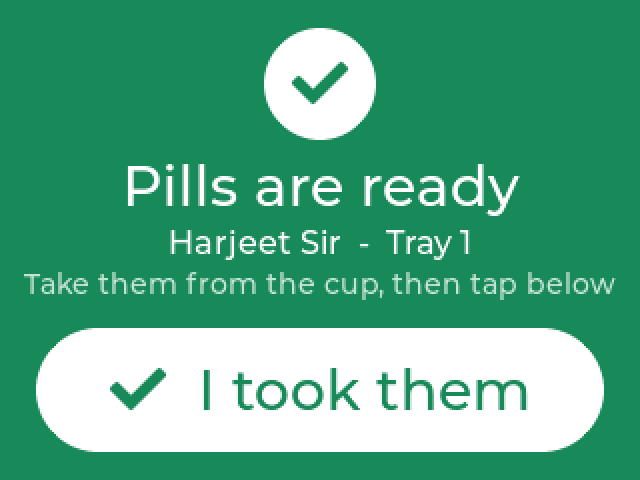 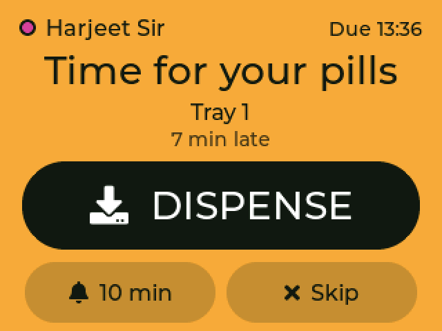

*Built by **Maverick Innovators***

</div>

---

## Contents
- [Why](#why)
- [Features](#features)
- [Screenshots](#screenshots)
- [Hardware](#hardware)
- [Quick start](#quick-start)
- [Setting up alerts](#setting-up-alerts)
- [AI assistant](#ai-assistant)
- [SD card](#sd-card)
- [How it works](#how-it-works)
- [Build from source](#build-from-source)
- [Developer tools](#developer-tools)
- [API](#api)
- [Project structure](#project-structure)
- [Team](#team)

---

## Why
Elderly and chronically ill patients often forget a dose, take it twice, or take it at the wrong time.
Family members who live away have no way of knowing. A pill box or a phone alarm doesn't confirm anything,
doesn't escalate, and keeps no record.

PillDispenser Pro handles the whole loop: **remind → dispense → confirm → escalate → record**.
It keeps working without internet and recovers on its own if something crashes.

## Features

### 💊 Dosing
- **Up to 4 dose times a day**, each with its own days of the week and an instruction ("1 tablet after breakfast").
- **One-touch dispensing:** a servo turns the 30-compartment tray and drops exactly one dose into the cup.
- **"I took them" confirmation.** The family is told if nobody confirms.
- **Escalation:** the patient is reminded every minute → the family is alerted after 15 min → the dose is marked *missed* after 2 h and a voice call is placed.
- **Snooze and skip** from the screen, the physical button, the web app or Telegram.
- **Pill stock count** with days left, a refill-by date, low-stock alerts and a refill wizard.

### 🛡️ Safety
- **Overdose lock:** a minimum gap between dispenses (default 2 h).
- **Early-dose window:** taking a dose a little early counts *as* that dose, so the alarm can't cause a second one.
- **Daily maximum** for as-needed medicines.
- **PIN** for dispensing or settings, and an optional **web password**.
- Never reports "dispensed" if the servo board isn't connected.

### 👨‍👩‍👧 Family
- **SOS button:** hold it on screen for 2 s, or hold the physical button for 5 s. Everyone is alerted and a voice call is placed. Family can tap *"I'm on my way"* and the patient sees it on the screen.
- **Messages to the screen** with read receipts (`/msg Please call me`).
- **Dispense alerts:** the family gets a message every time pills drop, and again when they are taken.
- **Daily check-in:** the family is told if there was no activity by a set time, plus a daily report.
- **Channels:** Telegram (two-way bot), WhatsApp, phone push (ntfy), voice call and webhook.

### 🤖 AI (Groq, free)
- **Scan a prescription:** photograph it, and the dose times, instructions and days are filled in for you (handles OD / BD / TDS / 1-0-1).
- **Ask the assistant** in Hindi, Punjabi, English or Hinglish: *"Kya aaj ki dawai le li?"*
- **AI adherence summary** for the doctor.
- **Telegram AI:** family can ask questions in plain words and the dispenser answers from its own live data.

### 🎵 Fun & faith
- **Party mode:** your songs on repeat, disco LEDs and a colour-changing screen.
- **Shabad Gurbani:** shabads play one after another, with a calm, slowly breathing saffron light.
- A medicine alarm or SOS always stops the music first.

### 📱 Two interfaces, one design
- **Touch screen:** a big next-dose card, today's doses as chips, a stock bar, a large SOS button, and full-screen alarm, ready and SOS screens you can read from across the room.
- **Phone web app**, served by the dispenser itself with nothing to install: Today · Schedule · History · Settings, in light and dark mode, plus a printable **doctor report** and CSV export.
- **Live dashboard** for a projector, and a **demo mode** (test dose in 1 minute, missed-dose demo).

### ⚙️ Reliability
- Works **completely offline**. Alarms and dispensing don't need internet.
- A due dose, or pills in the cup, **survive a power cut**.
- Watchdog, **safe mode** after repeated crashes, and **automatic rollback** to the previous firmware.
- Settings are kept in **two places** (file system + NVS), so they come back even if storage is wiped.
- Wi-Fi with a backup network, fast reconnect and self-repair. Setup hotspot with a QR code and a captive portal.
- Clock from NTP, the HTTP `Date` header, the phone or USB (the board has no RTC battery).
- **One-file over-the-air updates** from the web app. Settings and history are kept.

## Screenshots

### Touch screen (captured pixel-exact from the device)
| Home | Dose alarm | Dispensing | SOS |
|:-:|:-:|:-:|:-:|
|  |  | 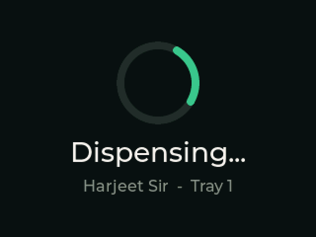 | 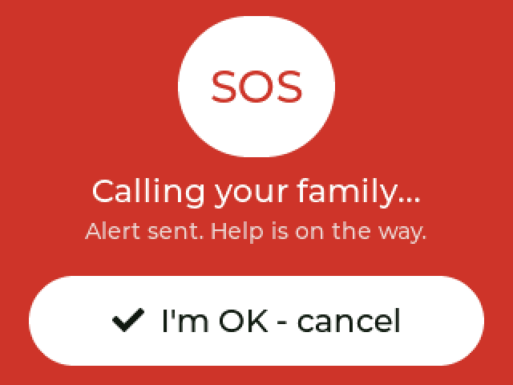 |
| **Family message** | **Pill tray** | **Refill wizard** | **Party mode** |
| 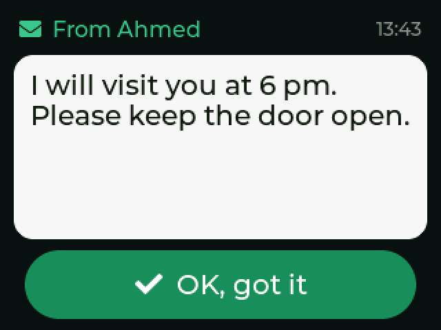 | 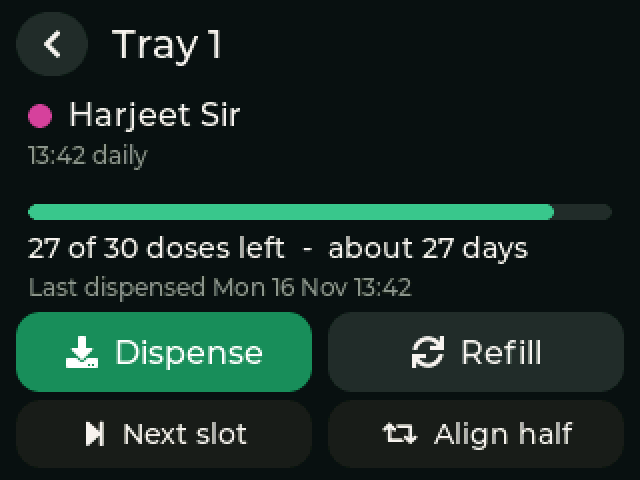 | 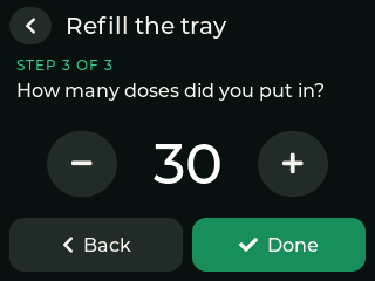 | 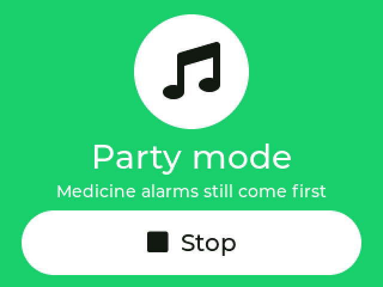 |

### Phone web app
**Today** (idle · dose due · pills ready · SOS)
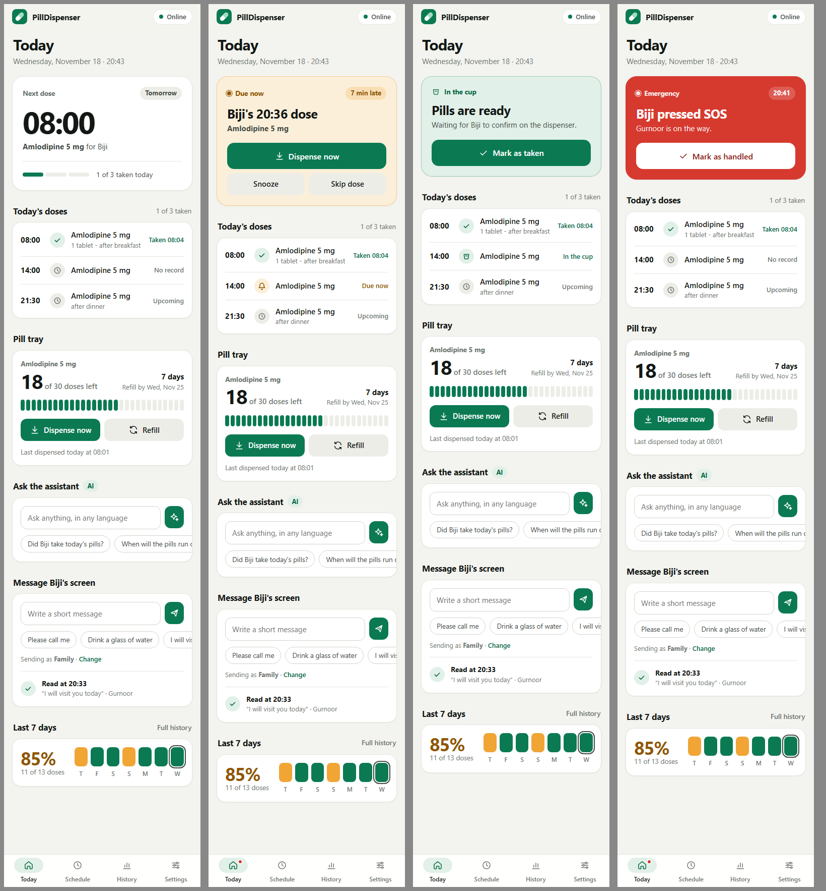

**Schedule · History · Settings · Family alerts**
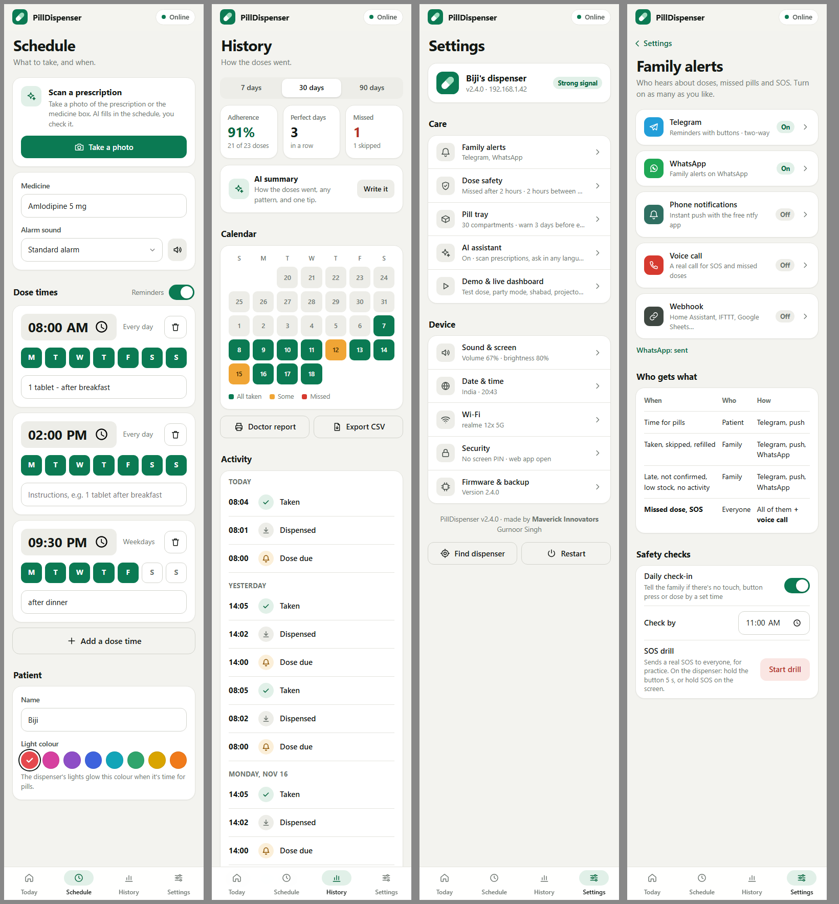

**AI:** ask in Hinglish · prescription scan · AI summary · settings
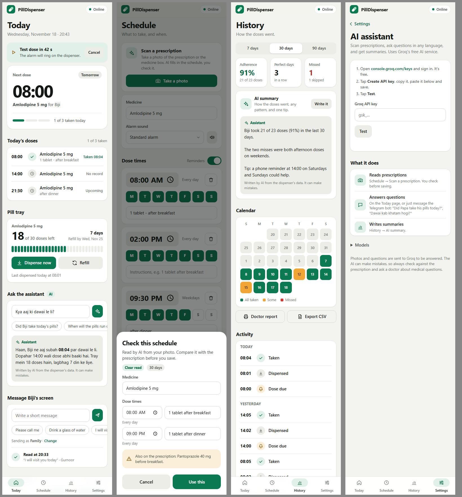

**Party mode · Shabad · Demo · Firmware**
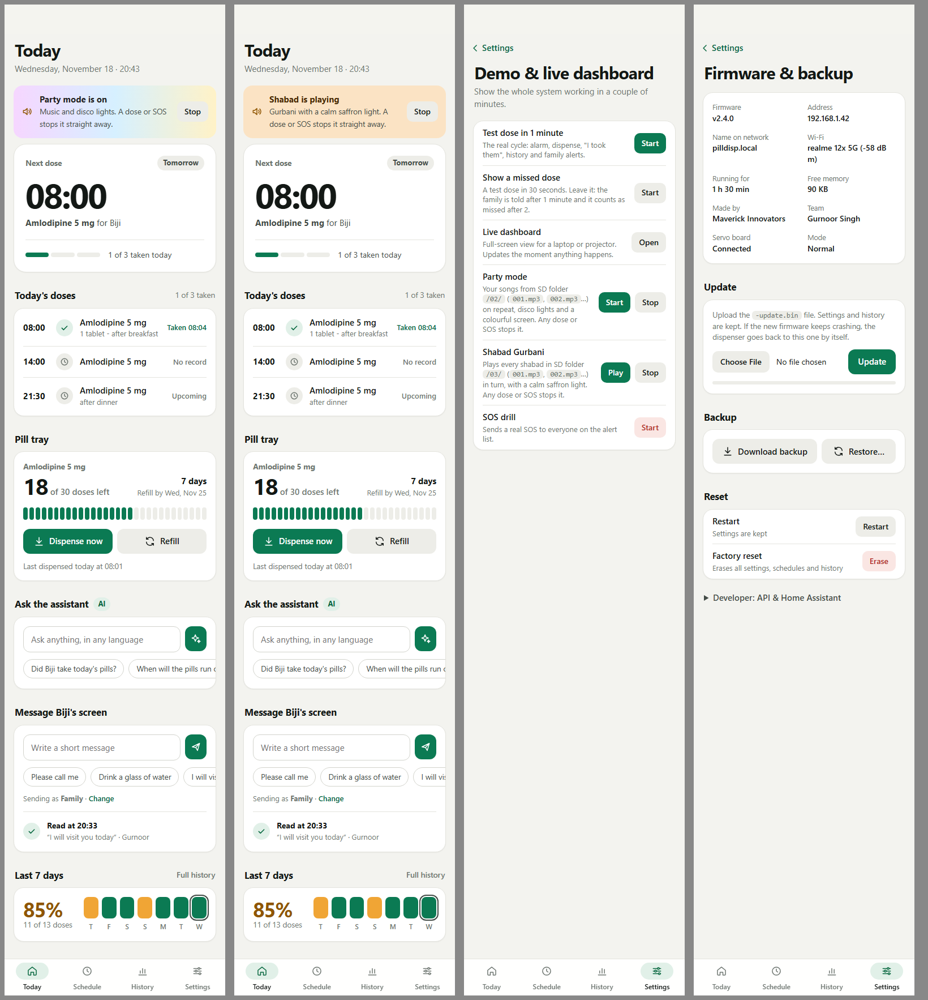

**Live dashboard** (projector view)
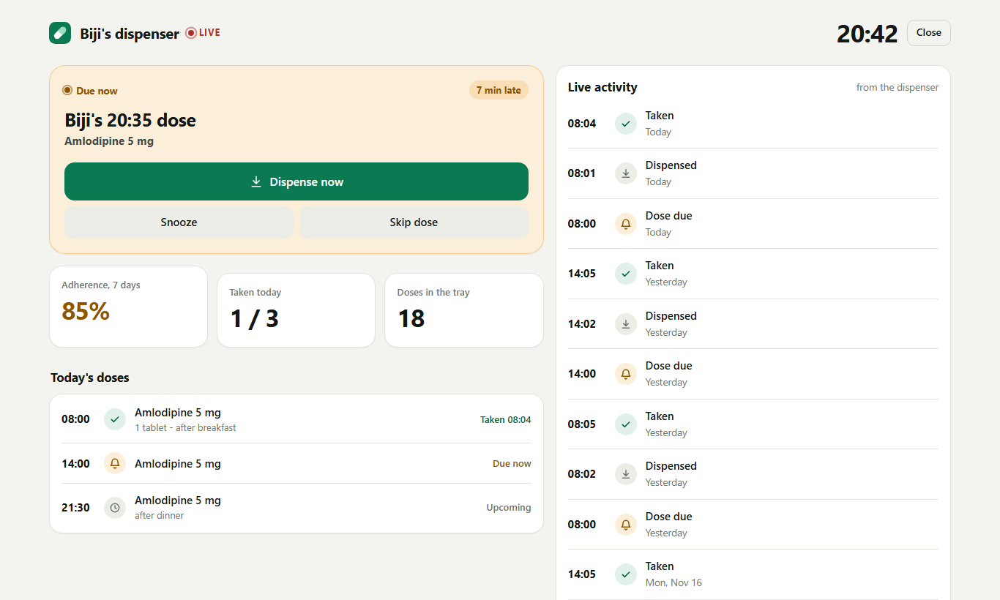

## Hardware

| Part | Notes |
|---|---|
| **ESP32-2432S028** ("Cheap Yellow Display") | ESP32-WROOM-32, 2.8" 320×240 ILI9341 TFT, XPT2046 resistive touch, 4 MB flash |
| **PCA9685** 16-channel PWM board | I²C 0x40, drives the servo |
| **SG90** micro servo | Turns the 30-compartment rotating tray |
| **2 × WS2812B** RGB LEDs | Status and party lights (via a 74AHCT125 level shifter) |
| **DFPlayer Mini** + micro-SD + 2 W speaker | Alarm, chime, voice prompts, music |
| Push button | Dispense / confirm / snooze / SOS |
| 5 V USB-C supply | About 500 mA |

### Pin map
| Function | ESP32 GPIO |
|---|---|
| TFT (HSPI) | MOSI 13 · MISO 12 · SCLK 14 · CS 15 · DC 2 · backlight 21 |
| Touch (XPT2046) | MOSI 32 · MISO 39 · CLK 25 · CS 33 · IRQ 36 |
| I²C → PCA9685 | SDA 22 · SCL 27 |
| WS2812B data | 16 |
| DFPlayer RX | 17 (TX only, 9600 baud) |
| Button (to GND) | 4 |

The servo can be plugged into **any** of the board's 10 tray headers: the firmware drives all of them.
One dose = 2 cycles of 180° push / 300 ms → 70° rest / 500 ms. All of these values can be changed in settings.

## Quick start

### 1. Flash
**USB** (new board). Get `esptool` and run:
```bash
esptool --chip esp32 --port COM11 --baud 921600 write_flash 0x0 release/PillDispenserPro-v2.4.0-full.bin
```
**Over Wi-Fi** (already running PillDispenser Pro): web app → **Settings → Firmware & backup → Update** → `release/PillDispenserPro-v2.4.0-update.bin`.

### 2. Connect to Wi-Fi
- On the touch screen: **⚙ → Wi-Fi network → Scan**, pick your network, type the password, then **Connect**.
- Or scan the QR code shown on first start to join the setup hotspot `PillDispenser-XXXX` from your phone.

> Using a phone hotspot? Set it to **2.4 GHz** (iPhone: *Maximise compatibility*) and turn off *auto-turn-off hotspot*.

### 3. Open the app
On the dispenser, go to **⚙ → Phone app & device info** and scan the QR code. Or open `http://pilldisp.local`.

### 4. Set up the medicine
In the web app:
1. **Schedule** → patient name, medicine, dose times and instructions. Or tap **Scan a prescription**.
2. Fill the tray and tap **Refilled**.

## Setting up alerts

<details>
<summary><b>Telegram bot</b> (recommended: two-way, free)</summary>

1. In Telegram, open **@BotFather**, send `/newbot`, choose a name and a username ending in `bot`, then copy the **token**.
2. Web app → **Settings → Family alerts → Telegram** → paste the token → **Save**.
3. Every person opens the new bot and taps **Start**. The bot replies with *"Your chat id: …"*.
4. Put the patient's id in **Patient chat ids** and the family ids (comma separated) in **Family chat ids**. Then **Save** → **Send test**.

| Command | Action |
|---|---|
| `/status` | Overview, next dose, stock |
| `/dispense` · `/dispense now` | Dispense the due dose · an extra dose |
| `/taken` · `/snooze` · `/skip` | Confirm · snooze · skip |
| `/refill [n]` | Tray refilled |
| `/msg <text>` | Show a message on the screen |
| `/coming` · `/ok` | "I'm on my way" · clear an SOS |
| `/party` · `/shabad` · `/stop` | Music modes |
| any sentence | Answered by the AI (when a Groq key is set) |

Only the chat ids you saved can control the dispenser.
</details>

<details>
<summary><b>WhatsApp</b> (alerts, via CallMeBot)</summary>

1. Save CallMeBot's WhatsApp number from [callmebot.com](https://www.callmebot.com/blog/free-api-whatsapp-messages/) and send it `I allow callmebot to send me messages`.
2. Enter your number (with `+91…`) and the API key you receive in **Settings → Family alerts → WhatsApp**, then tap **Send test**.
</details>

<details>
<summary><b>Phone push, voice call, webhook</b></summary>

- **Push:** install the free *ntfy* app and subscribe to the topic generated in the web app.
- **Voice call:** enter a Telegram username. It is used for SOS and missed doses (CallMeBot).
- **Webhook:** every alert is POSTed as JSON (Home Assistant, IFTTT, Google Sheets…).
</details>

## AI assistant
1. Create a free key at [console.groq.com/keys](https://console.groq.com/keys).
2. Paste it in **Settings → AI assistant**, then tap **Test**.

| Feature | Model | Where it runs |
|---|---|---|
| Prescription scan | `qwen/qwen3.8-27b` (vision) | Phone → Groq. The photo never passes through the ESP32. |
| Ask / AI summary | `openai/gpt-oss-120b` | Phone → Groq |
| Telegram questions | `openai/gpt-oss-120b` | Dispenser → Groq |

The assistant answers only from the dispenser's own data, keeps replies short, and **never gives medical advice**.
Both models can be changed in settings.

## SD card
Format the card as **FAT32** (32 GB or less). File names **must end in `.mp3`**.

```
/1-Alert.mp3          dose alarm      ← copy this first
/2-PillsReady.mp3     "pills ready" chime  ← copy this second
/01/001.mp3 …         optional voice prompts (Schedule → Alarm sound)
/02/001.mp3 …         Party mode songs (played in turn, on repeat)
/03/001.mp3 …         Shabads (played in turn, on repeat)
```
Copy the two root files **one at a time, in that order**: the DFPlayer numbers them in the order they were copied.
See [`sd-card/README.md`](sd-card/README.md).

## How it works

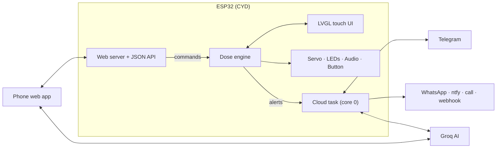

- **Two cores:** core 1 runs the UI, dose engine and hardware in a loop that never blocks. Core 0 runs every slow HTTPS call, so the screen never freezes.
- **Command queue:** the web server, Telegram and the button post commands that the main loop carries out, which avoids race conditions.
- **Dose life cycle:**

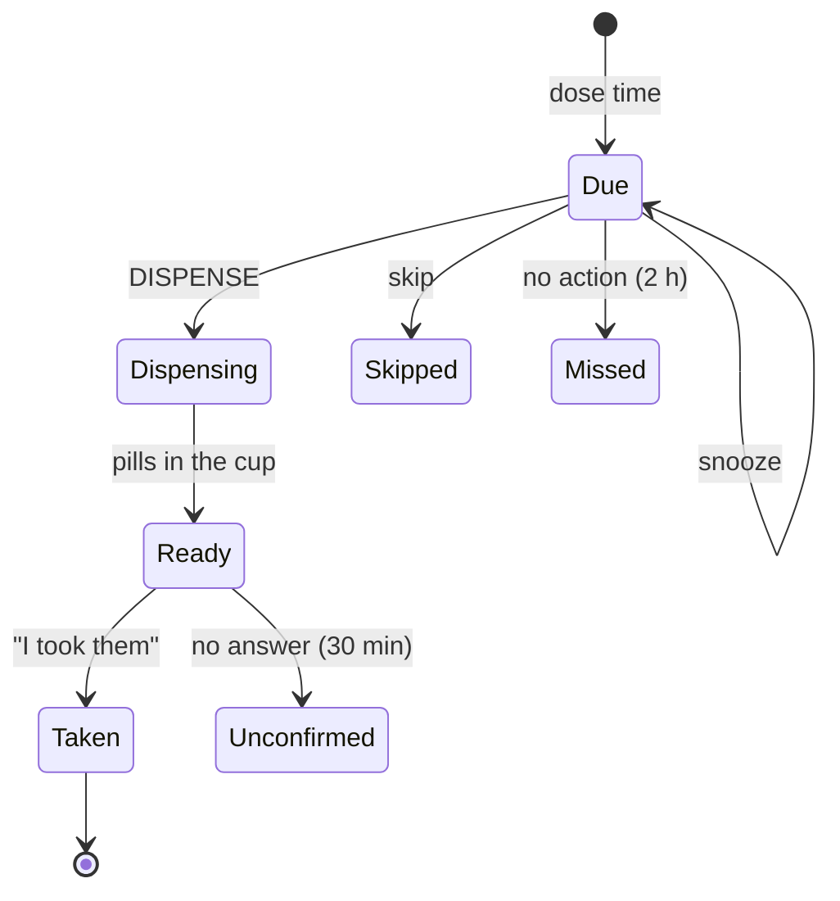

| Timer | Default | Result |
|---|---|---|
| Reminder sound | every 1 min | while the dose is due |
| Escalate | 15 min late | family alerted, with buttons |
| Missed | 120 min late | everyone alerted + voice call |
| Confirm | 30 min after dispensing | family told it was not confirmed |

## Build from source
- **Arduino ESP32 core 2.0.17**. Core 3.x crashes when Wi-Fi starts with these libraries.
- Board **ESP32 Dev Module**, partition scheme **Minimal SPIFFS (1.9 MB APP with OTA)**, flash 80 MHz.
- Libraries are included in [`libraries/`](libraries/), with LVGL and TFT_eSPI already configured.

**Windows (one click):**
```bat
tools\build.bat          :: build the web app + firmware → release\PillDispenserPro-v<ver>-update.bin
tools\build.bat COM11    :: build and flash over USB
```

**arduino-cli:**
```bash
python tools/build_web.py
arduino-cli compile --fqbn esp32:esp32:esp32:PartitionScheme=min_spiffs,FlashFreq=80 --libraries libraries PillDispenserPro
```
After editing `web/index.html`, run `tools/build_web.py`: it gzips the app into `PillDispenserPro/web_page.h` (about 115 KB → 34 KB).

## Developer tools
| Tool | What it does |
|---|---|
| `tools/screenshot.py COM11 h a b o m t f s i y` | Pixel-exact screenshots of the touch screen over USB |
| `tools/settime.py COM11` | Sets the clock and time zone from the PC |
| `tools/mock_server.py web/index.html 8701 idle` | Runs the web app on a PC with a fake dispenser (scenarios: `idle alert ready sos fresh low demo party shabad`) |

USB serial commands (115200 baud): `D` diagnostics (Wi-Fi, clock, internet, Telegram) · `M1` alarm · `M2` chime · `M100` party · `M101` shabad · `M0` stop · `M200` servo test.

## API
<details>
<summary>JSON endpoints</summary>

| Endpoint | Purpose |
|---|---|
| `GET /api/status` | Live state, tray, stock, next dose, SOS, message, Wi-Fi |
| `GET/POST /api/config` | Settings (secrets are masked) |
| `GET /api/history?days=N` | Events `[time, event, tray, slot, person]` |
| `POST /api/action?cmd=…` | `due taken snooze skip dispense refill advance align sound identify sos sos_clear msg ntest demo party settime reboot factory` |
| `GET /api/wifi/scan` · `POST /api/wifi` | Wi-Fi |
| `GET /api/backup` · `POST /api/restore` | Settings backup |
| `POST /api/update` | Firmware update (OTA) |

If a web password is set, every endpoint needs HTTP Basic auth (user `admin`).
</details>

## Project structure
```
PillDispenserPro/        firmware (Arduino sketch)
  PillDispenserPro.ino   boot, main loop, watchdog, crash guard
  app.cpp / app.h        dose engine, safety, SOS, messages, music, Telegram commands, AI
  hardware.cpp           servo queue, LEDs, DFPlayer, button, backlight
  storage.cpp            settings (file + NVS copy), state, history log
  net.cpp                Wi-Fi, setup hotspot, captive portal, diagnostics
  web.cpp                web server, JSON API, OTA
  telegram.cpp           alerts: Telegram, WhatsApp, ntfy, call, webhook, Groq
  ui.cpp                 LVGL touch interface
  web_page.h             generated: gzipped web app
web/index.html           phone web app source
libraries/               bundled, pre-configured libraries
tools/                   build, flash, screenshot, clock and mock-server tools
release/                 ready-to-flash firmware
docs/images/             screenshots
sd-card/                 SD card layout
```

## Team
**Maverick Innovators**

| Member | Contribution |
|---|---|
| **Gurnoor Singh** | Project coordination, material procurement, firmware development and research, progress reporting, documentation, report and presentations |
| **Ansh Sharma** | Mechanical design, 3D design and printing of the base, tray and mechanism, mechanical assembly and dimensional checks |
| **Samarpit Gujral** | Electronics design and wiring, firmware development, electronics testing |
| **Harman Singh Gill** | PCB work and soldering, inspection of the soldered boards, power and signal debugging |

All members took part in integration, testing and demonstrations.

## License
[MIT](LICENSE) for the PillDispenser Pro firmware and web app.
The bundled libraries in `libraries/` keep their own licences.
